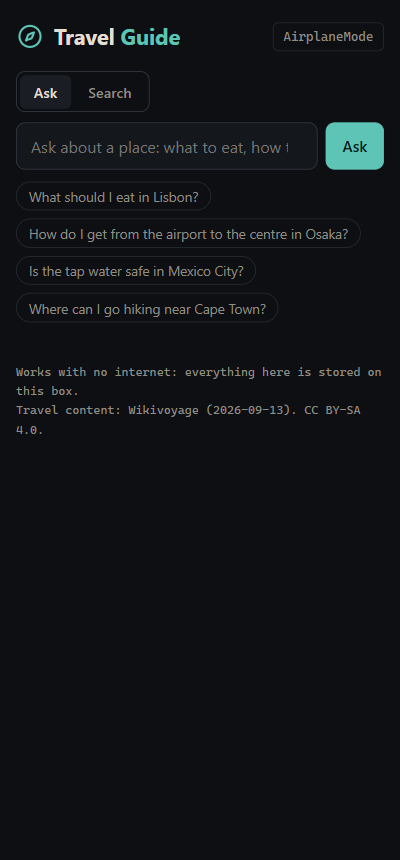
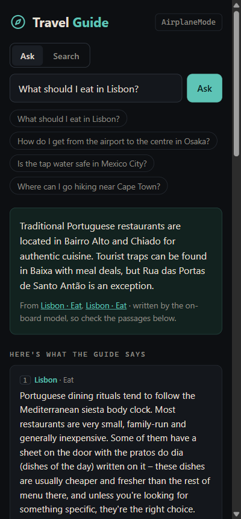
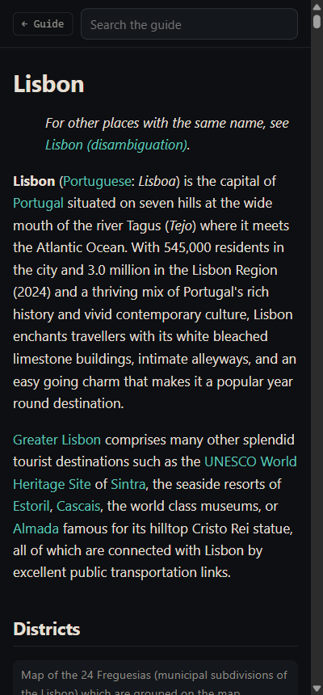

<p align="center"></p>

# Travel Guide: offline Wikivoyage, with answers

An [AirplaneMode](https://github.com/jessewolcott/airplanemode) app. The whole English
[Wikivoyage](https://en.wikivoyage.org) (68,000 destinations, 260 MB) on the box, readable with
no internet:

<p align="center">
  
  
  
</p>

<sub>Screenshots from the laptop dev stack; not yet tested on real hardware.</sub>

- **Search** every destination, with suggestions as you type and full-text results.
- **Read** articles in a clean, phone-friendly dark page. Links between articles work offline,
  addresses open in your map app (`geo:` links), phone numbers are tappable.
- **Ask** a question ("What should I eat in Lisbon?", "How do I get from the airport to the centre
  in Osaka?"). The guide finds the passages that answer it and shows them at once; then the
  on-board model writes a short answer from those passages only, with links to its sources.
  Without the model, the passages are the answer.

## Running it

**On the box:** the platform repo runs the released image at `/guide/`, with the shared model.
The first `scripts/update.sh` (while online) downloads the guide into the `guide-data` volume.

**On its own, for development:**

```
docker compose up -d --build        # http://localhost:8767
```

The first start downloads English Wikivoyage (~260 MB) and a 0.5B model (~400 MB). Use the
box's model with `MODEL=Qwen/Qwen2.5-1.5B-Instruct-GGUF:Q4_K_M`, or another port with `PORT=9000`.

**Tests** build a tiny guide with a few fake articles, so nothing is downloaded. libzim needs
Python 3.11+:

```
pip install -r requirements.txt && python tests/test_guide.py
# or in Docker (any OS):
docker run --rm -v "$PWD:/src" -w /src python:3.12-slim sh -c "pip install -r requirements.txt && python tests/test_guide.py"
```

**Releasing:** push a tag like `v0.1.0`. CI runs the tests and publishes
`ghcr.io/jessewolcott/airplanemode-guide:0.1.0` for arm64 and amd64.

## Content

Content is [Kiwix](https://kiwix.org) ZIM files, read directly with
[libzim](https://pypi.org/project/python-libzim/): no kiwix-serve, no unpacking.

| Setting | Default | |
|---|---|---|
| `ZIM_URL` | `https://download.kiwix.org/zim/wikivoyage/wikivoyage_en_all_nopic_2026-09.zim` | 272,495,142 bytes, full-text index included. Space-separated for several. Empty = never download. |
| `ZIM_SHA256` | pinned for the default | Otherwise Kiwix's `<url>.sha256` is used when it exists. |
| `ZIM_DIR` | `/data/zim` | Every `*.zim` here is served. |

- The download runs in the background, shows its progress on the page and in `GET /health`,
  resumes after a restart or a dropped connection (HTTP Range), and is checked (size and
  SHA-256) before it's used. Offline, it retries quietly with backoff.
- **Updating:** point `ZIM_URL` at a newer dated file (`…_2027-03.zim`). Once it's downloaded and
  checked, the older dated file of the same ZIM is removed.
- **More content:** drop any other `.zim` into `/data/zim` (say a Wikipedia subset, or
  `wikivoyage_en_europe_nopic` to save space) and restart. Search and ask cover all of them.
- Articles from the `nopic` variant have no pictures; that's what keeps it at 260 MB (the
  `maxi` one with pictures is 1 GB).

## How "ask" works

1. **Find articles.** Place names in the question (capitalised runs like "Mexico City", or the
   titles of full-text hits that appear in the question, for "what to eat in lisbon"), then
   full-text search. Up to 3 articles.
2. **Split** them into passages: listings and paragraphs, merged or split to ~110 words, each
   tagged with its section ("Get in › By plane").
3. **Rank** with BM25, plus a boost for the section the question is about (eat, sleep, get in,
   stay safe… mapped to Wikivoyage's standard sections), a boost for the named place's own
   article, and the place name itself left out of scoring. Identical passages (regions repeat
   each other) are dropped. The best ones are taken up to a token budget (`PASSAGE_TOKENS`, 900).
4. **Show** them straight away. That takes 0.1 s on a PC.
5. **Answer** (`POST api/answer`): the model gets the numbered passages and must reply in JSON
   (`answer`, `sources`), enforced by llama.cpp's grammar. A **deterministic guard** then
   rejects the answer if it contains a number that isn't in the passages, or if fewer than 60% of
   its content words are. Rejected, slow (`LLM_TIMEOUT`, 90 s), busy or missing model: the page
   keeps the passages and says why. `GET api/stats` counts answers used and rejected.

The model never sees anything but the passages, and its answer is always shown above the
passages it came from, labelled as written by the model.

## Safety

ZIM articles are HTML from a third party, and the app shares an origin with the box's admin
panel, so articles are never served as they are:

- cut down to the article body; scripts, styles, event handlers, forms, frames, inline SVG and
  `javascript:`/`data:` links removed (lxml, in `library.py`);
- served with `Content-Security-Policy: script-src 'none'`;
- other files from the ZIM: only CSS, images and fonts are served, never scripts, and with a
  `sandbox` CSP so an SVG opened directly can't run anything.

External links are marked (↗, "Needs the internet") and open in a new tab.

## Memory

Measured with the full English Wikivoyage open (PC, amd64):

| | RSS |
|---|---|
| started, ZIM open | ~35 MB |
| after browsing, searching and asking | ~75 MB anonymous, ~110 MB RSS |
| peak, 18 asks and page loads at once | 143 MB |

At most two articles are parsed at once, memory is handed back with `malloc_trim` afterwards,
and `MALLOC_ARENA_MAX=2` stops the thread pool keeping freed memory. libzim's cluster cache is
8 MB (`CLUSTER_CACHE_MB`). The platform limit is 256 MB.

## API

| | |
|---|---|
| `GET /health` | `{"content_ready", "zims", "download": {state, percent, …}, "llm"}`, for `update.sh` |
| `GET /api/suggest?q=` | title suggestions |
| `GET /api/search?q=` | full-text results with snippets |
| `POST /api/ask {question}` | passages, at once, and an `id` |
| `POST /api/answer {id}` | `{status: ok/rejected/timeout/busy/offline/none, answer, sources}` |
| `GET /api/stats` | answers used and rejected, and why |
| `GET /z/<zim>/<path>` | an article (or one of its CSS/image files) |

## Licence of the content

Wikivoyage text is CC BY-SA 4.0; every article page credits it and links to the original.
